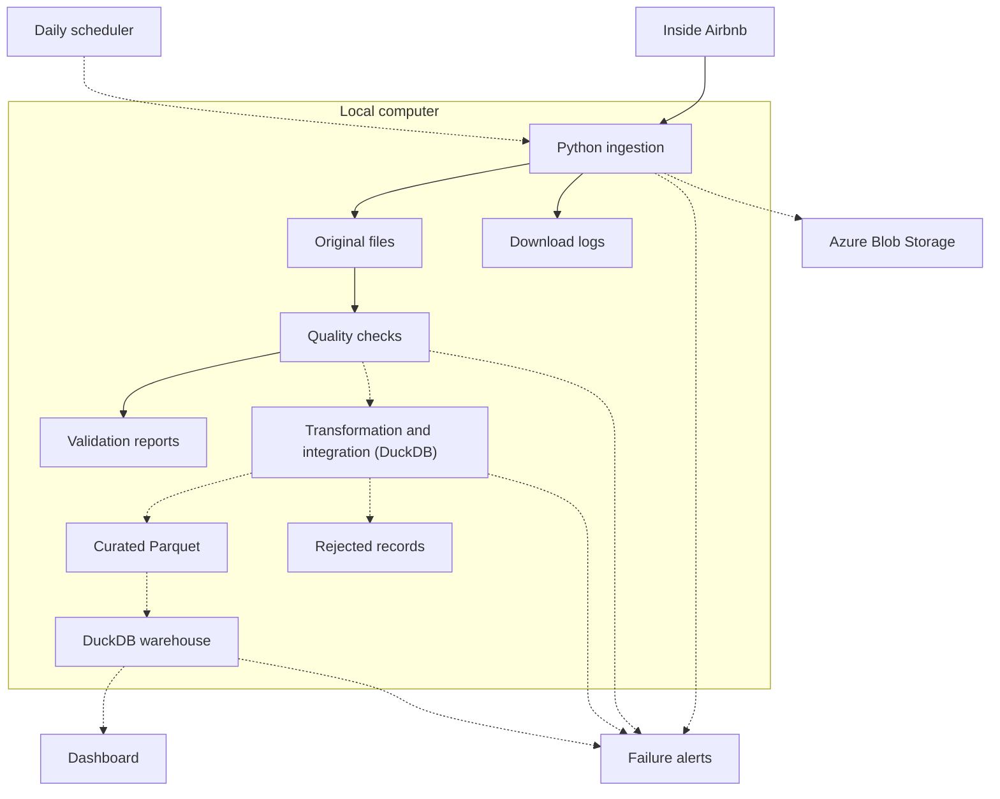

# Architecture and cluster design

## 1. Architecture overview

Our project uses a batch processing architecture. Python will download the Madrid Inside Airbnb datasets and coordinate every stage. Validation and transformation will run as SQL queries in DuckDB, called from Python. Cleaned files will be stored in Parquet format and loaded into a local DuckDB warehouse.

Azure Blob Storage will hold a cloud copy of the original files. SQL queries and a dashboard will use the warehouse to compare accommodation across neighbourhoods.

The first version will run on one team member's computer. Azure will provide remote storage, while processing and the warehouse will remain local.

## 2. System components

| Component | Role | Location |
|---|---|---|
| Inside Airbnb | Provides the four source datasets | External website |
| Python ingestion | Downloads the selected snapshot | Local computer |
| Raw storage | Keeps the original downloaded files | Local disk and planned Azure copy |
| Validation and transformation (DuckDB SQL run from Python) | Checks, cleans and integrates the data | Local computer |
| Parquet files | Store the cleaned datasets | Local disk |
| Rejected records | Store invalid records with rejection reasons | Restricted local folder |
| DuckDB warehouse | Stores the analytical tables | Local computer |
| Apache Airflow | Schedules and runs the pipeline once a day | Local computer (production option to be decided) |
| Dashboard | Presents aggregate results | Delivery tool to be selected |
| GitHub | Stores code, configuration examples and documentation | Shared repository |

Azure Blob Storage will be accessed through the Python SDK. Cloud credentials and personal configuration will remain outside GitHub.

## 3. Processing flow

The pipeline runner will coordinate the processing stages.

First, it will identify the source snapshot and download the required files. The original files will be kept unchanged in raw storage, and a copy will be uploaded to Azure Blob Storage.

The validation stage will check required columns, missing values, duplicate keys, dates and numerical values. Transformation will select the required fields and convert them to suitable types.

Both stages will be written as SQL queries executed by DuckDB through its Python API. DuckDB reads the compressed CSV files directly and writes Parquet, so the 8.4 million calendar rows do not have to be loaded into memory at once. Using the same engine for transformation and for the warehouse keeps the stack small.

Valid records will be written to Parquet. Rejected records will be stored separately with an explanation.

The warehouse loading stage will read the curated files and populate DuckDB tables. SQL queries and the dashboard will use the validated warehouse outputs.

Each stage will finish before the next dependent stage starts. The pipeline will stop if a required stage fails.

## 4. Data organisation

Files will be organised by snapshot date.

| Location | Contents |
|---|---|
| data/raw/2026-09-17/ | Original downloaded files |
| data/curated/2026-09-17/ | Cleaned Parquet files |
| data/rejected/2026-09-17/ | Rejected records and reasons |
| warehouse/airbnb.duckdb | Proposed analytical database |
| logs/ | Execution logs |
| evidence/ | Selected validation reports and evidence |

Azure Blob Storage will mirror the local structure, for example raw/2026-09-17/listings.csv.gz.

Source data, cleaned data and the warehouse will remain separate. This allows the team to repeat processing without changing the original files.

## 5. Integration rules

Listings will be connected to calendar and review records through the listing identifier.

The neighbourhood reference table will be matched using district and neighbourhood names. Unmatched values will be reported rather than silently discarded.

Calendar and review records will remain separate in the detailed model. For combined reports, their summaries will be calculated independently before being joined to listing information.

In the selected reviews file, the combination of listing_id and id is unique. Review ID alone will not be used as the record key.

## 6. Cluster design decision

We will start without a distributed cluster.

The selected listings, calendar and reviews files contain approximately ten million records in total. The record counts have been confirmed on a local computer. However, the full transformation and warehouse workload has not yet been measured.

A single-machine design is easier for our team to develop, test and explain. A cluster would introduce additional deployment and coordination work before we have evidence that it is needed.

We will measure processing time, peak memory use, disk space and query performance. We will first reduce unnecessary work by selecting the required columns, using Parquet and avoiding joins that multiply records. DuckDB supports this single-machine approach, because it processes large files in a columnar and parallel way without a separate server.

If the workload grows beyond the capacity of one machine, we will evaluate moving processing to a larger cloud machine or a distributed engine. These are future options, not components of the current implementation.

## 7. Scheduling and monitoring

Apache Airflow will start the pipeline once a day at 06:00 UTC. The schedule, task order and production options are described in the [orchestration plan](orchestration_plan.md). It will check whether a new Madrid snapshot is available.

If no new snapshot is found, the run will record that there is no update. If new data is available, the pipeline will process it and mark the snapshot as complete in the processed_snapshots table of the warehouse only after all required stages succeed.

The runner will prevent overlapping executions. Loading the same snapshot again must not create duplicate warehouse records.

Logs will record progress, record counts, durations and errors. Alerts will notify the team when a required stage fails. Their detailed implementation belongs to the orchestration and monitoring tasks.

## 8. Failure handling and access

Temporary outputs will be kept separate from published outputs. A failed run must not replace the last successful warehouse results with incomplete data.

The raw files and Azure copy will allow the team to repeat processing if local derived files are lost. The cloud copy must be tested before it is described as a working recovery mechanism.

Only one process will write to the local warehouse at a time. Dashboard refreshes and queries will be coordinated with warehouse publication.

Reviewer names and comments will be excluded from curated outputs because they are not needed for the analysis. Public outputs will contain aggregate results.

## 9. Implementation status

A first local prototype was discarded. Ingestion, validation and transformation are being reimplemented, with DuckDB as the processing engine.

The agreed design includes Azure Blob Storage, curated Parquet files and a DuckDB warehouse. Their implementation is still pending in the work reported here.

The orchestration plan has been written. Its implementation, integrated processing, alerting and dashboard delivery are still pending. The architecture describes the intended system and does not claim that all components are already deployed.

## Architecture diagram

Solid arrows show the core local path being implemented for Checkpoint 2. Dashed arrows show planned components and connections.

