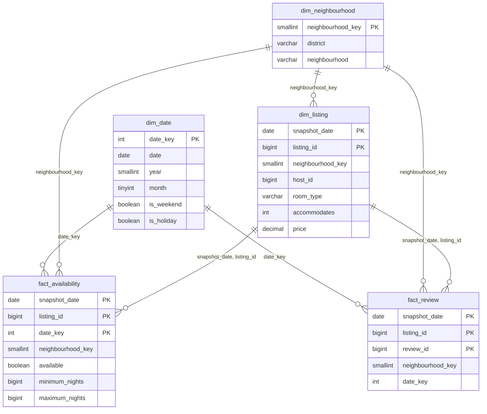

# Data warehouse model

**Status: in progress.** The schema is defined in [sql/create_tables.sql](../sql/create_tables.sql) and has been tested in DuckDB (it can be created more than once without errors). The loading step (`load_warehouse`) and the open decisions in section 5 are still pending.

## 1. Purpose

The warehouse answers the project questions: where Airbnb accommodation is concentrated in Madrid, and how advertised availability and review activity vary across neighbourhoods, room types and time. Almost every question has the same shape: *a measure* (availability, number of reviews, number of listings) *by* neighbourhood, room type and date. The model is designed around that shape.

## 2. Model overview

We use a **star schema** in DuckDB: two fact tables in the centre and three dimensions around them.

| Table | Type | One row is… | Approx. rows per snapshot |
|---|---|---|---:|
| `fact_availability` | Fact | one listing on one calendar day | 8.4 million |
| `fact_review` | Fact | one review | 1.5 million |
| `dim_listing` | Dimension | one listing | 23,109 |
| `dim_neighbourhood` | Dimension | one neighbourhood | 128 |
| `dim_date` | Dimension | one calendar day | one per day covered |
| `processed_snapshots` | Metadata | one processed snapshot | 1 |

The view `vw_listing_summary` gives the dashboard one row per listing of the latest snapshot, with its availability rate and review count.

## 3. Design decisions

### 3.1 Daily grain for availability

**Decision:** `fact_availability` stores one row per listing and calendar day, not a monthly summary.

**Why:** short-term rental demand changes from one day to the next. Christmas, Easter week or local holidays such as San Isidro (15 May) behave very differently from the rest of the same month, and a monthly average would hide these peaks. A fine grain can always be aggregated later (by week, month or season), but an aggregated table can never be split back into days. The `is_holiday` and `is_weekend` columns of `dim_date` make these comparisons direct in the dashboard.

**Trade-off:** a larger table (8.4 million rows per snapshot). This is not a problem for DuckDB: the whole integration of these rows runs in about 10 seconds on a laptop.

### 3.2 Two fact tables instead of one

**Decision:** availability and reviews are kept in separate fact tables.

**Why:** they have different grains (a listing on a day versus a review event). Joining them in one table would repeat every review once per calendar day of its listing and multiply the counts. This is the same rule already applied in the integration step: each fact is aggregated separately before being combined.

### 3.3 Star schema instead of snowflake

**Decision:** the fact tables contain `neighbourhood_key` directly, so the neighbourhood is reached in one join. In a snowflake design, the facts would only contain `listing_id`, and the neighbourhood would be reached through `dim_listing` (two joins).

**Why:** we measured both versions with the 8.4 million real availability rows of snapshot 2026-09-17 in DuckDB, running the same query (average availability by neighbourhood). The script is [evidence/benchmark_star_vs_snowflake.py](../evidence/benchmark_star_vs_snowflake.py) and its output is saved in `evidence/benchmark_star_vs_snowflake_2026-09-17.json`:

| | Snowflake | Star |
|---|---|---|
| Warehouse size | 19.1 MB | 19.1 MB |
| Query time (median of 9 runs) | 139.5 ms | 84.0 ms |

The extra column costs almost no space, because DuckDB stores data by column and compresses repeated values: the 365 consecutive rows of a listing all have the same neighbourhood, so the value is stored once with a repeat count. The query is about 1.7 times faster because one join is removed. Absolute timings depend on the machine; the script can be run again to reproduce the comparison. Star schemas are also easier to use in dashboard tools and easier to explain.

**Trade-off:** the neighbourhood of a listing is stored in more than one place, so the load must keep them consistent. This is checked by `validate_curated`.

### 3.4 Snapshot history with `snapshot_date`

**Decision:** every fact row and every listing row carries the `snapshot_date` it comes from. New snapshots are added; old ones are kept.

**Why:** Inside Airbnb publishes periodic snapshots (a "photo" of Airbnb Madrid at one moment). Two snapshots can describe the same day differently. For example, 24 December may appear unavailable in the September snapshot and available in the December one. Two different dates must therefore be stored:

- `date_key`: the day the row talks about;
- `snapshot_date`: the snapshot the row comes from.

This also supports the orchestration plan: a snapshot can be reloaded by deleting and inserting its rows in one transaction, without duplicates, and `processed_snapshots` records which snapshots are complete. For the same reason, `dim_listing` keeps one version of each listing per snapshot, so a price change between snapshots does not overwrite history.

**Trade-off:** the warehouse grows with each new snapshot. This growth is part of the scalability analysis (×10 to ×10,000).

### 3.5 Inside Airbnb ids as listing keys

**Decision:** listings are identified by the original `listing_id`. Only `dim_neighbourhood` uses a small surrogate key (`neighbourhood_key`), and `dim_date` uses a readable `YYYYMMDD` key.

**Why:** we verified that `listing_id` is unique and never missing in the snapshot. A separate surrogate key would add code to generate and maintain it without a real benefit at this stage. For neighbourhoods, a two-byte number is much cheaper to repeat in millions of fact rows than two text columns.

### 3.6 No foreign key constraints in the database

**Decision:** relationships are documented and checked by the pipeline, but not declared as foreign keys in DuckDB.

**Why:** foreign keys would force a strict delete and insert order during the idempotent reload of a snapshot. The same guarantees are already enforced before loading by `validate_curated` (every `listing_id` and neighbourhood must match its reference, and no output may be empty), which stops the run if a check fails.

### 3.7 Privacy by design

**Decision:** the warehouse stores no reviewer names, reviewer ids, review comments, host names or free-text descriptions.

**Why:** they are not needed for the analysis, so they are never read from the source files.

## 4. How the model answers the project questions

| Question | Tables used |
|---|---|
| Which neighbourhoods have the most listings, and of which type? | `dim_listing` + `dim_neighbourhood` |
| How does availability change over time and by neighbourhood or room type? | `fact_availability` + `dim_date` + `dim_neighbourhood` (+ `dim_listing` for room type) |
| Do holidays and weekends behave differently? | `fact_availability` + `dim_date` (`is_holiday`, `is_weekend`) |
| Where is review activity highest, and how does it change over time? | `fact_review` + `dim_date` + `dim_neighbourhood` |
| How do reviews relate to the number of listings? | `vw_listing_summary` |

## 5. Open decisions (to be closed after Checkpoint 2)

| Topic | Options | Current choice |
|---|---|---|
| Holiday list for `is_holiday` | Fixed list in the repository / public holiday API | Pending; column defaults to false |
| `host_id` | Keep / replace with a pseudonymous hash / remove | Kept for now; to be reviewed in the privacy reflection |
| Dashboard tool | Looker Studio (needs exported data) / Streamlit (reads DuckDB directly) | Pending |
| Reviews grain | Detailed (current) / daily aggregate per listing | Detailed, 1.5 million rows is small |

## 6. Next steps

1. Implement `load_warehouse`: fill the dimensions, then the facts, using delete-and-insert by `snapshot_date` in one transaction.
2. Implement `mark_processed`: insert the snapshot into `processed_snapshots` after every task succeeds.
3. Build `dim_date` with the holiday list.
4. Connect the dashboard to `vw_listing_summary` and the fact tables.
