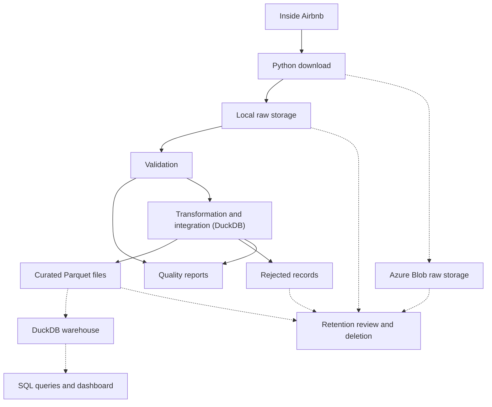

# Data lifecycle mapping

## Project scope

Our project uses four Inside Airbnb datasets for Madrid from the snapshot labelled 17 September 2026.

The datasets contain listing information, calendar availability, reviews and a neighbourhood reference table. We will combine them to compare Airbnb accommodation across Madrid neighbourhoods.

Our agreed architecture uses Python to coordinate the pipeline, DuckDB SQL for validation and transformation, Parquet for cleaned files, a local DuckDB warehouse and Azure Blob Storage for a cloud copy of the original data.

## 1. Data source

The original files are available from Inside Airbnb.

https://insideairbnb.com/get-the-data/

We use listings.csv.gz, calendar.csv.gz, reviews.csv.gz and neighbourhoods.csv.

The snapshot date (2026-09-17) identifies the selected publication and is used to name every folder and output. Individual records may have different collection dates.

## 2. Ingestion

Python reads the dataset URLs from config/sources.json and downloads the files.

Each download is first saved with a temporary .part extension. When it finishes successfully, the file receives its final name. Progress and errors are recorded in a log.

This step is implemented in `pipeline/ingestion.py`, and the four files of snapshot 2026-09-17 have been downloaded with it. A file that is already in raw storage is not downloaded again. The planned daily process will check for new snapshots. If no new snapshot is available, it will record that the check finished without an update.

## 3. Raw storage

Original files are stored locally in data/raw/2026-09-17/. They are not edited manually.

We will also upload a copy to Azure Blob Storage using the Python SDK. Files will follow the same folder structure as local storage, for example raw/2026-09-17/listings.csv.gz.

The local files are available. The cloud storage step is planned.

Large datasets and credentials will remain outside GitHub. The repository will contain the source configuration, processing code, documentation and selected evidence.

## 4. Validation

Validation runs at two points.

Before transformation (`validate_raw`), each file must exist, contain the required columns and have at least one data row.

During and after transformation (`transform_clean` and `validate_curated`), each record is checked for missing or invalid keys, duplicate keys, valid dates, numeric values, availability values, known room types and matching listings and neighbourhoods. The run stops if a dataset is empty or no valid listing remains.

The integration report (`evidence/2026-09-17_integration_report.json`) records these counts.

| Dataset | Records |
|---|---:|
| Listings | 23,109 |
| Calendar | 8,438,629 |
| Reviews | 1,524,765 |
| Neighbourhoods | 128 |

All records passed validation: no record was rejected. Prices that are present but cannot be converted to a number are counted in the report; there were none in this snapshot.

The checked keys are unique for listings, calendar and neighbourhoods. Some review IDs appear under different listings, but the combination of listing_id and id is unique in this file. This combination is used as the review key.

The snapshot label is not the collection date. The data was collected between 19 and 22 September 2026, so review dates are checked against the latest collection date (`last_scraped`), not against 17 September.

Validation never edits the raw files. Invalid records are moved to the rejected layer with their reason.

## 5. Transformation and integration

This stage is implemented in `pipeline/integration.py`. SQL queries executed by DuckDB from Python select the columns needed for analysis, remove unnecessary spaces and convert values to suitable types. DuckDB reads the compressed source files directly and writes Parquet without loading whole datasets into memory. The whole stage takes about 10 seconds for snapshot 2026-09-17.

Records that fail the validation rules are stored separately with a rejection reason. A non-empty price that cannot be converted is kept as a missing price, so the listing still counts, but it is counted and logged as a warning.

Listings are matched to the neighbourhood reference table using district and neighbourhood names. Calendar and review records are linked to listings through listing_id.

Calendar and review summaries are calculated separately before being combined with listing information in `listing_summary`. A direct join between both detailed datasets would multiply records and produce incorrect counts.

Reviewer names, reviewer ids and comments are never read, because they are not needed for the analysis.

## 6. Curated storage

Cleaned datasets are saved as Parquet files in data/curated/2026-09-17/, together with `listing_summary.parquet`.

Rejected records are saved in data/rejected/2026-09-17/ with the reasons for rejection.

Outputs identify their source snapshot. Original files will remain separate so that processing can be repeated.

## 7. Warehouse loading

The cleaned data will be loaded into a local DuckDB warehouse.

The warehouse will contain related tables for listings, neighbourhoods, dates, availability and review activity. The model is described in [data_model.md](data_model.md) and its schema is defined in `sql/create_tables.sql`. The loading step is still pending.

Processing the same snapshot again must not create duplicate warehouse records. An incomplete load must not replace the last successful published results.

## 8. Consumption

SQL queries and a dashboard will allow users to compare listing counts, accommodation types, advertised availability and review activity across neighbourhoods.

Outputs will show the snapshot and time period used. Unavailable dates will not be treated as confirmed bookings, and review counts will not be treated as booking counts.

Users will receive aggregate results rather than personal reviewer information.

## 9. Retention and deletion

We propose keeping the selected source files, validation reports and derived outputs until grading is complete.

After grading, the team will review which files still need to be retained. Unnecessary personal data and temporary files will be deleted from local and cloud storage.

Rejected records will be accessible only to the team and kept only while needed to investigate data quality problems.

Daily log files are planned to be kept for 30 days, as described in [logging_alerting.md](logging_alerting.md). Automatic deletion of old logs is not implemented yet.

## Current status

Local ingestion, transformation and integration are implemented. The repository includes an integration report for snapshot 2026-09-17. The pipeline produces curated Parquet files, rejected records and a listing-level summary. Azure storage, automatic snapshot detection, scheduled execution and warehouse loading are still pending. The warehouse schema is defined in SQL.

Dashboard delivery and retention are also planned stages.

This document describes the lifecycle design. It does not claim that the complete pipeline is already implemented.

## Lifecycle diagram

Solid arrows show implemented stages. Dashed arrows show planned stages.

