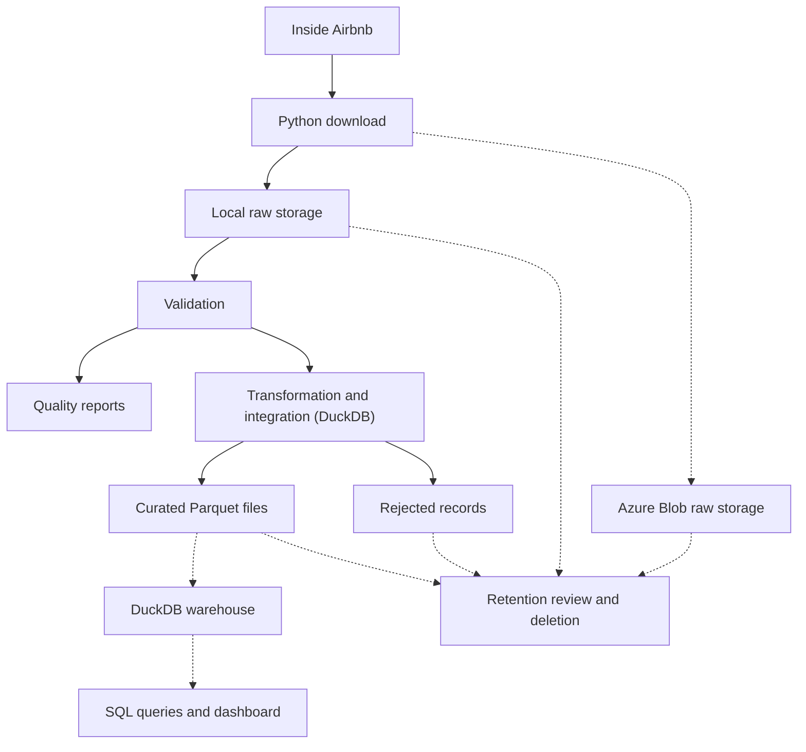

# Data lifecycle mapping

## Project scope

Our project uses four Inside Airbnb datasets for Madrid from the snapshot labelled 17 September 2026.

The datasets contain listing information, calendar availability, reviews and a neighbourhood reference table. We will combine them to compare Airbnb accommodation across Madrid neighbourhoods.

Our agreed architecture uses Python to coordinate the pipeline, DuckDB SQL for validation and transformation, Parquet for cleaned files, a local DuckDB warehouse and Azure Blob Storage for a cloud copy of the original data.

## 1. Data source

The original files are available from Inside Airbnb.

https://insideairbnb.com/get-the-data/

We use listings.csv.gz, calendar.csv.gz, reviews.csv.gz and neighbourhoods.csv.

The snapshot date (2026-09-17) identifies the selected publication and is used to name every folder and output. Individual records may have different collection dates.

## 2. Ingestion

Python reads the dataset URLs from config/sources.json and downloads the files.

Each download is first saved with a temporary .part extension. When it finishes successfully, the file receives its final name. Progress and errors are recorded in a log.

The download step is implemented in pipeline/ingestion.py. Files that are already in raw storage are not downloaded again, so a failed run can be repeated safely. The planned daily process will check for new snapshots. If no new snapshot is available, it will record that the check finished without an update.

## 3. Raw storage

Original files are stored locally in data/raw/2026-09-17/. They are not edited manually.

We will also upload a copy to Azure Blob Storage using the Python SDK. Files will follow the same folder structure as local storage, for example raw/2026-09-17/listings.csv.gz.

The local files are available. The cloud storage step is planned.

Large datasets and credentials will remain outside GitHub. The repository will contain the source configuration, processing code, documentation and selected evidence.

## 4. Validation

Before transforming the data, we check file readability, required columns, missing values and duplicate keys.

The completed local checks found these record counts.

| Dataset | Records |
|---|---:|
| Listings | 23,109 |
| Calendar | 8,438,629 |
| Reviews | approx. 1.5 million |
| Neighbourhoods | 128 |

No missing values were found in the selected columns.

The checked keys are unique for listings, calendar and neighbourhoods. Some review IDs appear under different listings, but the combination of listing_id and id is unique in this file. We will use this combination as the review key.

Validation runs in two gates. Before transformation, validate_raw checks that every file exists, is not empty and has the required columns. After transformation, validate_curated checks unique keys and that every listing and neighbourhood matches its reference table. Dates, numerical fields, availability values and relationships between datasets are checked row by row during transformation (section 5). If a gate fails, the run stops.

## 5. Transformation and integration

This stage is implemented in pipeline/integration.py. SQL queries executed by DuckDB from Python select the columns needed for analysis, remove unnecessary spaces and convert values to suitable types. DuckDB reads the compressed source files directly and writes Parquet without loading whole datasets into memory.

Records that fail the agreed validation rules are stored separately with a rejection reason. Unusual values will be investigated before deciding whether to exclude them.

Listings are matched to the neighbourhood reference table using district and neighbourhood names. Calendar and review records are linked to listings through listing_id.

Calendar and review summaries are calculated separately before combining them with listing information. A direct join between both detailed datasets would multiply records and produce incorrect counts.

Reviewer names and comments are never read from the source file, because they are not needed for the planned analysis.

## 6. Curated storage

Cleaned datasets are saved as Parquet files in data/curated/2026-09-17/.

Rejected records are saved in data/rejected/2026-09-17/ with the reasons for rejection. For snapshot 2026-09-17 no record was rejected (see evidence/2026-09-17_integration_report.json).

Outputs identify their source snapshot. Original files will remain separate so that processing can be repeated.

## 7. Warehouse loading

The cleaned data will be loaded into a local DuckDB warehouse.

The warehouse will contain related tables for listings, neighbourhoods, dates, availability and review activity. Its detailed model and loading process will be developed as a separate team task.

Processing the same snapshot again must not create duplicate warehouse records. An incomplete load must not replace the last successful published results.

## 8. Consumption

SQL queries and a dashboard will allow users to compare listing counts, accommodation types, advertised availability and review activity across neighbourhoods.

Outputs will show the snapshot and time period used. Unavailable dates will not be treated as confirmed bookings, and review counts will not be treated as booking counts.

Users will receive aggregate results rather than personal reviewer information.

## 9. Retention and deletion

We propose keeping the selected source files, validation reports and derived outputs until grading is complete.

After grading, the team will review which files still need to be retained. Unnecessary personal data and temporary files will be deleted from local and cloud storage.

Rejected records will be accessible only to the team and kept only while needed to investigate data quality problems.

## Current status

Ingestion, raw storage, validation, transformation, integration and curated storage work end to end on a local computer for snapshot 2026-09-17. Every run is logged, and a failed run sends an alert (see the [logging and alerting design](logging_alerting.md)).

The Azure copy of the raw files, warehouse loading, dashboard delivery and the retention review remain planned stages.

## Lifecycle diagram

Solid arrows show stages that are implemented and tested. Dashed arrows show planned stages.

