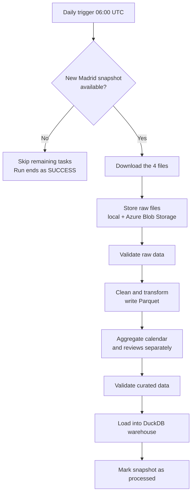

# Orchestration Plan: Madrid Short-Term Rental Observatory

---

## 1. Objective

Run the whole pipeline **automatically once a day**. Each daily run must:

1. Check whether Inside Airbnb has published a **new Madrid snapshot**.
2. If yes, run the full ETL: download, validate, transform, and load into the data warehouse.
3. If no, end successfully without reprocessing anything.

Inside Airbnb does not publish daily, so most runs will find nothing new. This is expected, and it still satisfies the requirement that all processes are orchestrated to run at least once a day.

---

## 2. Technology Stack and Decisions

**Chosen by the team:**

| Area | Choice |
|---|---|
| Main language | Python |
| Orchestrator | Apache Airflow |
| Transformation engine | DuckDB SQL, run from Python |
| Data format | Parquet |
| Data warehouse | DuckDB |
| Cloud storage | Azure Blob Storage |
| Snapshot tracking | `processed_snapshots`, a metadata table inside the data warehouse |
| Schedule | Daily run, in UTC |
| Task timeout | 60 minutes |

---

## 3. Schedule

| Item | Setting |
|---|---|
| DAG ID | `madrid_airbnb_daily` |
| Schedule | `0 6 * * *`: every day at 06:00 UTC |
| Catch-up | Disabled (`catchup=False`). The source is a snapshot, not a daily feed, so missed days do not need back-filling |
| Concurrency | `max_active_runs=1`. This also protects the DuckDB warehouse, which accepts only one writing process at a time |
| Task timeout | 60 minutes per task (`execution_timeout`) |

**Why 60 minutes is realistic:** on a day with a new snapshot, ingesting and loading the ~8.4M-row `calendar.csv` fits within the limit. On a day with no new snapshot, the run only executes `check_new_snapshot` and finishes in under a minute.

---

## 4. Pipeline Flow



---

## 5. Tasks and Dependencies

Tasks run in strict sequence. A task only starts if the previous one succeeded. Every task has a 60-minute timeout.

| # | Task | Purpose | Retries |
|---|---|---|---|
| 1 | `check_new_snapshot` | Finds the latest Madrid snapshot date and compares it with the `processed_snapshots` table. If already processed, all downstream tasks are skipped | 3 (5 min apart) |
| 2 | `download_files` | Downloads `listings`, `calendar`, `reviews` and `neighbourhoods` | 3 (exponential backoff) |
| 3 | `store_raw` | Keeps the original files unchanged in `data/raw/<snapshot_date>/` and uploads a copy to Azure Blob Storage | 2 |
| 4 | `validate_raw` | Gate: files exist, are not empty, and have the expected columns | 0 |
| 5 | `transform_clean` | Cleans types, dates and prices with DuckDB SQL and drops unneeded columns. Valid rows are written as Parquet to `data/curated/`; invalid rows go to `data/rejected/` with the reason | 1 |
| 6 | `aggregate_calendar_reviews` | Builds listing-level availability and review summaries **separately** before joining, to avoid duplicated counts. The detailed calendar and review data are kept for the warehouse | 1 |
| 7 | `validate_curated` | Gate: keys are unique, and every `listing_id` and neighbourhood matches its reference table | 0 |
| 8 | `load_warehouse` | Loads the Parquet data into DuckDB: dimension tables first, then fact tables | 2 |
| 9 | `mark_processed` | Records the snapshot in `processed_snapshots`. Runs **last**, only if everything before it succeeded | 2 |

Rules behind these choices:

- **Network tasks retry** (tasks 1 and 2), because downloads can fail temporarily.
- **Validation gates never retry** (tasks 4 and 7), because bad data will not fix itself. They stop the run.
- **`mark_processed` is always last**, so a failed run never leaves a snapshot marked as done.

---

## 6. Snapshot Tracking and Idempotency

The same snapshot must never be loaded twice, and re-running a task must never create duplicates.

- **State table:** `processed_snapshots(snapshot_date, run_id, loaded_at, status)` is a metadata table inside the data warehouse, next to the fact and dimension tables.
- **Check step:** `check_new_snapshot` compares the latest published date with this table. If the date is present, the run ends with no updates.
- **Raw layer is immutable:** files go to `data/raw/YYYY-MM-DD/` locally and to `raw/YYYY-MM-DD/` in Azure Blob Storage, and are never overwritten.
- **Idempotent load:** every fact row carries a `snapshot_date`. The load deletes any existing rows for that date and inserts the new ones in one transaction. Running the same snapshot twice gives the same result.
- **Failed run recovery:** if the run fails before `mark_processed`, the snapshot is still "new" on the next daily run, which retries it automatically.

---

## 7. Manual Runs

| Case | How |
|---|---|
| Reprocess a specific snapshot (e.g. after fixing a bug) | Trigger the DAG with the parameter `force_snapshot_date=YYYY-MM-DD`. This skips the "already processed" check and relies on the idempotent load |
| Load the first snapshot / initial setup | Trigger the DAG manually once, before the schedule starts |
| Pause the pipeline | Pause the DAG in Airflow. No tasks run until it is resumed |

---

## 8. Production Equivalent (Proposal, Not Yet Decided)

Leaving Airflow running permanently on a laptop is not realistic, so the repository should include a configuration that would run the same pipeline daily in production, even if we do not leave it running. The team has not yet chosen where this runs. Options, all using the same schedule (`0 6 * * *`, UTC) and the same task order:

| Option | How it works |
|---|---|
| A. Airflow in a container on an Azure compute service | The same DAG file runs unchanged on a hosted Airflow instance |
| B. Scheduled Azure container job | A cron-triggered job runs `python -m pipeline.run_daily`, which executes tasks 1 to 9 in order. It could be created from Python with the Azure SDK (`deploy/create_schedule.py`) |
| C. Plain `cron` (minimal fallback) | `0 6 * * * cd /opt/madrid-airbnb && python -m pipeline.run_daily` on any always-on machine with its clock in UTC |

Only the runner changes between options.

---

## 9. Illustrative DAG Skeleton

```python
from datetime import timedelta
import pendulum
from airflow import DAG
from airflow.operators.python import PythonOperator, ShortCircuitOperator

from pipeline.checks import is_new_snapshot
from pipeline.tasks import (download_files, store_raw, validate_raw,
                            transform_clean, aggregate_all,
                            validate_curated, load_warehouse, mark_processed)

default_args = {
    "owner": "nicolas",
    "retries": 2,
    "retry_delay": timedelta(minutes=5),
    "retry_exponential_backoff": True,
    "execution_timeout": timedelta(minutes=60),   # per-task timeout
}

with DAG(
    dag_id="madrid_airbnb_daily",
    schedule="0 6 * * *",                          # 06:00 UTC
    start_date=pendulum.datetime(2026, 11, 1, tz="UTC"),
    catchup=False,
    max_active_runs=1,                             # DuckDB: one writer at a time
    default_args=default_args,
) as dag:

    check = ShortCircuitOperator(task_id="check_new_snapshot",
                                 python_callable=is_new_snapshot, retries=3)
    download = PythonOperator(task_id="download_files", python_callable=download_files, retries=3)
    raw = PythonOperator(task_id="store_raw", python_callable=store_raw)
    v_raw = PythonOperator(task_id="validate_raw", python_callable=validate_raw, retries=0)
    clean = PythonOperator(task_id="transform_clean", python_callable=transform_clean, retries=1)
    agg = PythonOperator(task_id="aggregate_calendar_reviews", python_callable=aggregate_all, retries=1)
    v_cur = PythonOperator(task_id="validate_curated", python_callable=validate_curated, retries=0)
    load = PythonOperator(task_id="load_warehouse", python_callable=load_warehouse)
    done = PythonOperator(task_id="mark_processed", python_callable=mark_processed)

    check >> download >> raw >> v_raw >> clean >> agg >> v_cur >> load >> done
```

---

## 10. Repository Files

```text
dags/madrid_airbnb_daily.py     # Airflow DAG
pipeline/run_daily.py           # single entry point (used by a container job / cron)
pipeline/checks.py              # snapshot detection
docker-compose.yml              # local Airflow
docs/orchestration_plan.md      # this document
```

If option B is chosen in section 8, we would add `deploy/create_schedule.py`.
