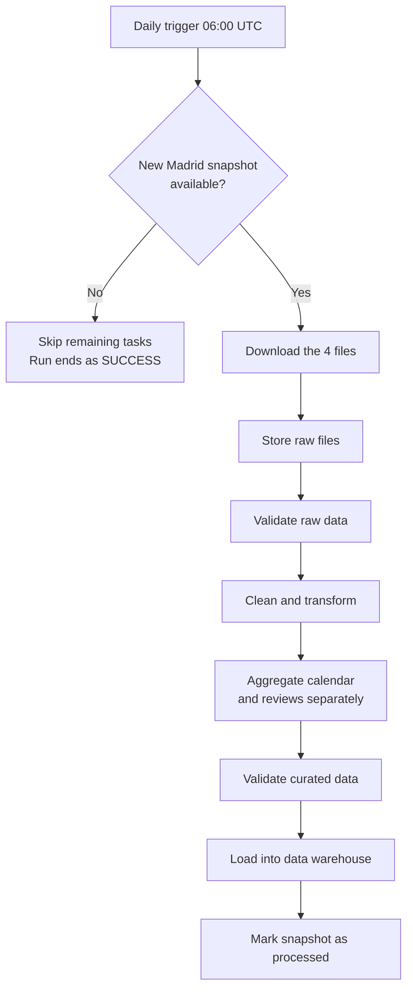

# Orchestration Plan: Madrid Short-Term Rental Observatory

**Owner:** Nicolás García (Orchestration & Quality Lead)
**Status:** Draft for Checkpoint 2

> Logging and alerting are designed in a separate document and are not covered here.

---

## 1. Objective

Run the whole pipeline **automatically once a day**. Each daily run must:

1. Check whether Inside Airbnb has published a **new Madrid snapshot**.
2. If yes, run the full ETL: download, validate, transform, and load into the data warehouse.
3. If no, end successfully without reprocessing anything.

Inside Airbnb does not publish daily, so most runs will find nothing new. This is expected, and it still satisfies the requirement that all processes are orchestrated to run at least once a day.

---

## 2. Orchestrator and Schedule

| Item | Decision |
|---|---|
| Orchestrator | **Apache Airflow 2.x**, run locally with Docker Compose for development and the demo |
| Cloud provider | **AWS** |
| DAG ID | `madrid_airbnb_daily` |
| Schedule | `0 6 * * *`: every day at 06:00 **UTC** |
| Catch-up | Disabled (`catchup=False`). The source is a snapshot, not a daily feed, so missed days do not need back-filling |
| Concurrency | `max_active_runs=1`, so two runs can never load data at the same time |
| Task timeout | **60 minutes per task** (`execution_timeout`) |

**Why 60 minutes is realistic:** on a day with a new snapshot, ingesting and loading the ~8.4M-row `calendar.csv` fits within the limit. On a day with no new snapshot, the run only executes `check_new_snapshot` and finishes in under a minute.

---

## 3. Pipeline Flow



---

## 4. Tasks and Dependencies

Tasks run in strict sequence. A task only starts if the previous one succeeded. Every task has a 60-minute timeout.

| # | Task | Purpose | Retries |
|---|---|---|---|
| 1 | `check_new_snapshot` | Finds the latest Madrid snapshot date and compares it with the `processed_snapshots` table. If already processed, all downstream tasks are skipped | 3 (5 min apart) |
| 2 | `download_files` | Downloads `listings`, `calendar`, `reviews` and `neighbourhoods` | 3 (exponential backoff) |
| 3 | `store_raw` | Saves the original files unchanged in the raw layer (Amazon S3), partitioned by snapshot date | 2 |
| 4 | `validate_raw` | Gate: files exist, are not empty, and have the expected columns | 0 |
| 5 | `transform_clean` | Cleans types, dates and prices, removes duplicates, drops unneeded columns | 1 |
| 6 | `aggregate_calendar_reviews` | Aggregates availability and reviews **separately** before joining, to avoid duplicated counts | 1 |
| 7 | `validate_curated` | Gate: keys are unique, and every `listing_id` and neighbourhood matches its reference table | 0 |
| 8 | `load_warehouse` | Loads dimension tables first, then fact tables | 2 |
| 9 | `mark_processed` | Records the snapshot in `processed_snapshots`. Runs **last**, only if everything before it succeeded | 2 |

Rules behind these choices:

- **Network tasks retry** (tasks 1 and 2), because downloads can fail temporarily.
- **Validation gates never retry** (tasks 4 and 7), because bad data will not fix itself. They stop the run.
- **`mark_processed` is always last**, so a failed run never leaves a snapshot marked as done.

---

## 5. Snapshot Tracking and Idempotency

The same snapshot must never be loaded twice, and re-running a task must never create duplicates.

- **State table:** `processed_snapshots(snapshot_date, run_id, loaded_at, status)` is a **metadata table inside the data warehouse**, next to the fact and dimension tables.
- **Check step:** `check_new_snapshot` compares the latest published date with this table. If the date is present, the run ends with no updates.
- **Raw layer is immutable:** files go to `raw/snapshot_date=YYYY-MM-DD/` and are never overwritten.
- **Idempotent load:** every fact row carries a `snapshot_date`. The load deletes any existing rows for that date and inserts the new ones in one transaction (or uses `MERGE`). Running the same snapshot twice gives the same result.
- **Failed run recovery:** if the run fails before `mark_processed`, the snapshot is still "new" on the next daily run, which retries it automatically.

---

## 6. Manual Runs

| Case | How |
|---|---|
| Reprocess a specific snapshot (e.g. after fixing a bug) | Trigger the DAG with the parameter `force_snapshot_date=YYYY-MM-DD`. This skips the "already processed" check and relies on the idempotent load |
| Load the first snapshot / initial setup | Trigger the DAG manually once, before the schedule starts |
| Pause the pipeline | Pause the DAG in Airflow. No tasks run until it is resumed |

---

## 7. Production Equivalent on AWS

Leaving Airflow running permanently on a laptop is not realistic. The repository will therefore include a configuration that would run the same pipeline daily on AWS, even if we do not leave it running. The schedule resources are created from Python with `boto3` (`deploy/create_schedule.py`), not through the console.

| Option | How it works |
|---|---|
| **Primary: Amazon MWAA** (Managed Workflows for Apache Airflow) | Runs the same DAG file with no changes. The DAG's own `0 6 * * *` UTC schedule triggers it daily |
| Alternative: EventBridge Scheduler → ECS Fargate | EventBridge Scheduler fires `cron(0 6 * * ? *)` (UTC) and starts a containerised Fargate task that executes `python -m pipeline.run_daily`, which runs tasks 1 to 9 in order |
| Minimal fallback: `cron` | `0 6 * * * cd /opt/madrid-airbnb && python -m pipeline.run_daily` on any always-on machine (server clock in UTC) |

All three use the same schedule and the same task order. Only the runner changes.

---

## 8. Illustrative DAG Skeleton

```python
from datetime import timedelta
import pendulum
from airflow import DAG
from airflow.operators.python import PythonOperator, ShortCircuitOperator

from pipeline.checks import is_new_snapshot
from pipeline.tasks import (download_files, store_raw, validate_raw,
                            transform_clean, aggregate_all,
                            validate_curated, load_warehouse, mark_processed)

default_args = {
    "owner": "nicolas",
    "retries": 2,
    "retry_delay": timedelta(minutes=5),
    "retry_exponential_backoff": True,
    "execution_timeout": timedelta(minutes=60),   # per-task timeout
}

with DAG(
    dag_id="madrid_airbnb_daily",
    schedule="0 6 * * *",                          # 06:00 UTC
    start_date=pendulum.datetime(2026, 11, 1, tz="UTC"),
    catchup=False,
    max_active_runs=1,
    default_args=default_args,
) as dag:

    check = ShortCircuitOperator(task_id="check_new_snapshot",
                                 python_callable=is_new_snapshot, retries=3)
    download = PythonOperator(task_id="download_files", python_callable=download_files, retries=3)
    raw = PythonOperator(task_id="store_raw", python_callable=store_raw)
    v_raw = PythonOperator(task_id="validate_raw", python_callable=validate_raw, retries=0)
    clean = PythonOperator(task_id="transform_clean", python_callable=transform_clean, retries=1)
    agg = PythonOperator(task_id="aggregate_calendar_reviews", python_callable=aggregate_all, retries=1)
    v_cur = PythonOperator(task_id="validate_curated", python_callable=validate_curated, retries=0)
    load = PythonOperator(task_id="load_warehouse", python_callable=load_warehouse)
    done = PythonOperator(task_id="mark_processed", python_callable=mark_processed)

    check >> download >> raw >> v_raw >> clean >> agg >> v_cur >> load >> done
```

---

## 9. Repository Files

```text
dags/madrid_airbnb_daily.py     # Airflow DAG
pipeline/run_daily.py           # single entry point (used by Fargate / cron)
pipeline/checks.py              # snapshot detection
deploy/create_schedule.py       # boto3 script that creates the AWS schedule
docker-compose.yml              # local Airflow
docs/orchestration_plan.md      # this document
```

---

## 10. Confirmed Decisions

| Decision | Outcome |
|---|---|
| Orchestrator and cloud provider | Apache Airflow on AWS |
| Location of `processed_snapshots` | Metadata table inside the data warehouse |
| Schedule and timeout | Daily run in UTC, 60-minute task timeout |
